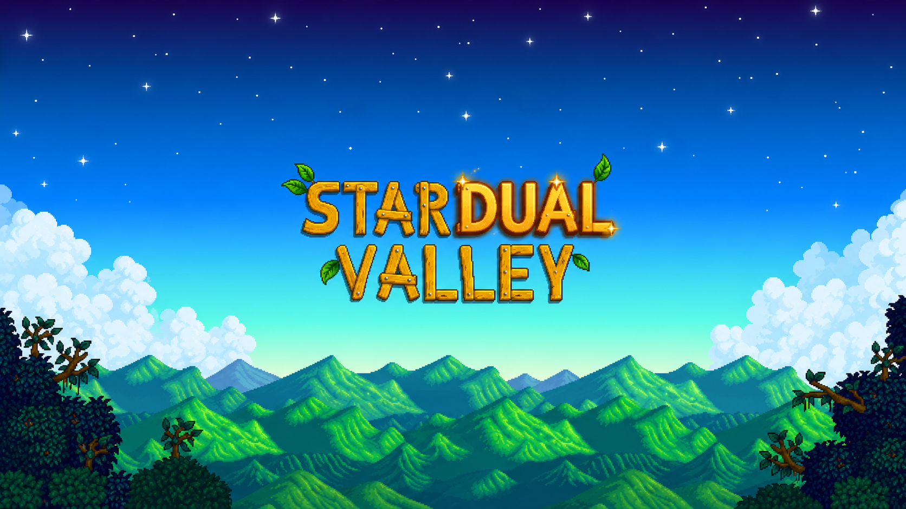

# Stardual Valley



A lower-screen companion for **Stardew Valley on Android**, running on the AYN
Thor. The top screen plays the game; the bottom screen shows your day, map,
farm, journal, bundles, calendar and backpack, live.

**Modded for Android by [breepear](https://github.com/breepear).**

> [!IMPORTANT]
> **Stardual Valley only works with the Android version of Stardew Valley,
> running through SMAPI Launcher.** SMAPI Launcher is required: without it the
> mod can't load and Stardual Valley has nothing to connect to.
>
> **Playing the PC (Steam) version of Stardew through Cinderbox or WEMU? This
> isn't for you. Use JoeCorrell's original
> [AYN Thor DualScreen Mods](https://github.com/JoeCorrell/AYN-Thor-Dualscreen-Mods)
> instead.** It's built for the PC version and supports it properly.

## Credits

Stardual Valley is built on
[AYN Thor DualScreen Mods](https://github.com/JoeCorrell/AYN-Thor-Dualscreen-Mods)
by **[JoeCorrell](https://github.com/JoeCorrell)**, with the Stardew Valley mod
by **Profmags**. They made the companion app and the mod; all of that work is
theirs. This fork adapts it for the Android version of Stardew Valley (instead
of the PC version running through WEMU) and gives the app its own name and logo.

The upstream project has no license, so its authors keep all rights to their
code. If you are JoeCorrell or Profmags and want anything changed or taken down,
please open an issue.

## Download

Get the latest **Stardual Valley APK** from the
[Releases page](../../releases/latest). You also need the Stardew mod from the
[upstream v2.0 release](https://github.com/JoeCorrell/AYN-Thor-Dualscreen-Mods/releases/tag/v2.0)
(`StardewDualScreenMod.zip`), and Stardew Valley running through SMAPI Launcher.
Follow [Setup](#setup) below.

## What changed in this fork

- **App name:** "DualScreen Mods" is now "Stardual Valley"
  (`src/main/res/values/strings.xml`).
- **App icon:** the upstream app had none. The Stardual Valley logo
  (`assets/stardual-valley-logo.png`), a big star and a small star for the
  Thor's two screens, is the launcher icon, in `src/main/res/mipmap-*` and
  wired up in `src/main/AndroidManifest.xml`.
- **`tools/repack-apk.sh`:** builds the renamed app from the upstream release
  APK. See [Building the app](#building-the-app) for why.
- **Start screen:** while you wait for a game, the lower screen shows the
  Stardual Valley title art (`src/main/res/drawable-nodpi/stardual_home.png`)
  full screen, with a hint at the bottom: "Launch Stardew Valley through SMAPI
  to connect Stardual." Once the game connects it reads "Connected! Load a save
  in Stardew Valley to begin.", and when a save loads the art steps aside for
  the Stardew pages. This replaces the upstream multi-game list, so the app only
  ever shows Stardew. The screen is `overlay/src/com/stardual/StardualActivity.java`,
  which becomes the app's launcher activity (see [Building the app](#building-the-app)).
- **Android setup docs:** see [Setup](#setup).

No code changes were needed to run on Android. The upstream v2.0 release mod
and app work as they are.

## Requirements

Stardual Valley needs all of these:

- **An AYN Thor** (or another dual-screen Android device; only the Thor is tested).
- **Stardew Valley for Android**, bought from Google Play (or the Galaxy
  Store), version 1.6.15.3 or later. The PC version doesn't work with this app.
- **SMAPI Launcher with SMAPI for Android installed.** Required. This is what
  loads mods into the Android game.
- **The Stardew Valley Dual Screen Mod**, which runs inside the game and feeds
  the app.
- **The Stardual Valley app.**

Tested on an AYN Thor (Android 13) with:

| Piece | Version |
| --- | --- |
| Stardew Valley (Google Play) | 1.6.15.3 |
| [SMAPI Launcher](https://github.com/NRTnarathip/SMAPILoader/releases) | 1.1.7 |
| [SMAPI for Android](https://www.nexusmods.com/stardewvalley/mods/44436) | 4.3.2.5 |
| [Stardew Valley Dual Screen Mod](https://github.com/JoeCorrell/AYN-Thor-Dualscreen-Mods/releases/tag/v2.0) | 2.0.0 |
| Stardual Valley | latest [release](../../releases/latest) |

## Setup

### Step 1: Set up SMAPI Launcher (required)

SMAPI Launcher runs the Android version of Stardew Valley with mods. Do this
first; nothing else works without it.

1. **Install Stardew Valley** from Google Play and open it once to make sure
   it runs.
2. **Remove other Stardew mod loaders.** If you've used Cinderbox or another
   loader with the Android game, uninstall it and delete any leftover
   `StardewValley/smapi-internal` folder in your device storage. Leftover
   loader files can make the game stick on a white screen.
3. **Install SMAPI Launcher.** Download `SMAPI-Launcher-v1.1.7.apk` from the
   [SMAPI Launcher releases](https://github.com/NRTnarathip/SMAPILoader/releases)
   and install it. Android may ask you to allow installs from your browser or
   file manager.
4. **Download SMAPI for Android 4.3.2.5** from
   [Nexus Mods](https://www.nexusmods.com/stardewvalley/mods/44436?tab=files)
   (you need a free Nexus account; choose **Manual download**). Use this Nexus
   version: the older 4.3.2.1 build on GitHub shows a white screen with
   Stardew 1.6.15.3.
5. **Install SMAPI.** Open SMAPI Launcher, tap **Install SMAPI From Zip**, and
   pick the zip you downloaded. The launcher only accepts a zip whose file
   name contains `SMAPI-Android` (the Nexus download already does; rename it
   if you've changed the name). Wait for **"Successfully Install SMAPI"**.
6. **Check it works.** Tap **Start Game**. The title screen should show
   `SMAPI v4.3.2.5` in the bottom-left corner.

> [!NOTE]
> SMAPI Launcher keeps its own mods and saves, separate from the regular game:
>
> - Mods go in `Android/data/abc.smapi.gameloader/files/Mods/`
> - Saves are in `Android/data/abc.smapi.gameloader/files/Saves/`
>
> Your existing farm won't appear in SMAPI until you copy its save folder from
> `Android/data/com.chucklefish.stardewvalley/files/Saves/` into SMAPI's
> `Saves` folder. Always start the game from **SMAPI Launcher**, not the
> regular Stardew Valley icon, or mods won't load.

### Step 2: Install the Dual Screen mod

1. Download `StardewDualScreenMod.zip` from the
   [upstream v2.0 release](https://github.com/JoeCorrell/AYN-Thor-Dualscreen-Mods/releases/tag/v2.0).
2. Extract it and copy the `StardewDualScreenMod` folder into
   `Android/data/abc.smapi.gameloader/files/Mods/`.

The upstream README says this mod needs SMAPI 4.5; its `manifest.json` actually
asks for 4.0.0, and Android SMAPI 4.3.2.5 loads it without errors.

### Step 3: Install Stardual Valley

Download `Stardual-Valley.apk` from the [Releases page](../../releases/latest)
and install it. If Joe's original DualScreen Mods app is installed, uninstall it
first: both use the same package name but are signed with different keys.

### Step 4: Play

1. Open **Stardual Valley** on the lower screen. It shows the title art and
   says to launch Stardew Valley through SMAPI.
2. Start the game from **SMAPI Launcher** on the top screen. When the mod
   connects, the lower screen says to load a save.
3. Load your farm. The lower screen switches to your day, map, farm, journal,
   bundles, calendar and backpack.

To open the app on the lower screen over adb (display 4 on the Thor):

```bash
adb shell am start --display 4 -n com.wemu.dualscreenmods/com.stardual.StardualActivity
```

### Troubleshooting

- **The lower screen never says "Connected".** Make sure you started the game
  from SMAPI Launcher (not the regular Stardew icon) and that the
  `StardewDualScreenMod` folder is in SMAPI's `Mods` folder. Check the SMAPI
  log at `Android/data/abc.smapi.gameloader/files/ErrorLogs/SMAPI-latest.txt`:
  it should show `Listening on ws://127.0.0.1:7786` when the mod starts and
  `wemu connected` when the app connects.
- **The game sticks on a white screen.** Use SMAPI for Android 4.3.2.5 from
  Nexus, and remove leftover files from other mod loaders (see Step 1).
- **The game's HUD is missing on the top screen.** That's intended: the mod
  moves that information to the lower screen. The app's Settings page has the
  mod's options.

## Building the app

The app can't be compiled from this repo alone: `DualScreenActivity.kt` imports
`ThorTheme`, `ModsPage` and `SecondScreen` from shared libraries that aren't
published here. Instead, `tools/repack-apk.sh` downloads the upstream release
APK, applies this repo's name, icon and start screen, and signs it with your own
key. The start screen is a small Java activity (`overlay/src`) compiled against
stand-in declarations of the upstream classes it calls (`overlay/stubs`, not
packaged); the script adds it to the APK as an extra dex file and makes it the
launcher activity. It reuses the upstream screen's content, so everything else
behaves exactly as before:

```bash
APKTOOL_JAR=/path/to/apktool.jar \
BUILD_TOOLS=~/Library/Android/sdk/build-tools/37.0.0 \
ANDROID_JAR=~/Library/Android/sdk/platforms/android-36/android.jar \
KEYSTORE=~/stardual.keystore KEYSTORE_PASS=yourpass \
tools/repack-apk.sh
```

The result is `.repack/stardual-valley.apk`. Because it is signed with a
different key than the upstream app, uninstall the upstream app before
installing it the first time. Keep your keystore safe and out of git: every
later build must use the same key to update in place.

The launcher icon is an adaptive icon
(`src/main/res/mipmap-anydpi-v26/ic_launcher.xml`). The logo is the background
layer (`ic_launcher_background.png`), scaled so the whole image fills the middle
72dp that a round launcher shows, with its edges mirrored out to the full 108dp
layer. The foreground layer (`ic_launcher_foreground.png`) is empty. The
`ic_launcher.png` files are the plain logo for older Android versions. To change
the icon, regenerate those files in every `mipmap-<density>` folder from a new
`assets/stardual-valley-logo.png` (layers: 108, 162, 216, 324 and 432 px;
plain icons: 48, 72, 96, 144 and 192 px).

---

## Upstream README

The rest of this file is the original project's README, kept for reference. It
describes the **PC version** of Stardew running through WEMU, so its downloads
and installation steps are not for Stardual Valley. For Android, follow
[Setup](#setup) above.

Native lower-screen companions for games running through WEMU on the AYN Thor.
The Android companion keeps useful information and touch controls on the lower
display while the game remains playable on the upper display.

The current release includes the DualScreen Android app and the Stardew Valley
SMAPI integration.

## Downloads

Open the [latest release](https://github.com/JoeCorrell/AYN-Thor-Dualscreen-Mods/releases/latest) and download:

- `DualScreen Mods.apk` for the AYN Thor lower screen.
- `WemuSecondScreen.zip` for a complete Stardew Valley mod installation.
- `StardewDualScreen.dll` when updating an existing mod folder manually.

## Stardew Valley pages

| Page | Contents |
| --- | --- |
| Today | Weekday, date, time, weather, luck, gold, energy, health, shipping, skills, hotbar, and all unlocked backpack rows |
| Map | Stardew's valley map, the current location, and the farmer marker |
| Farm | Tall, independently scrollable machine, animal, and fruit-tree lists with compact farm summaries |
| Journal | Active quests, objectives, deadlines, rewards, and cancellation where Stardew permits it |
| Bundles | Community Center rooms, bundle progress, and missing item icons |
| Calendar | A fixed four-week season calendar with weekday headers, birthday portraits and labels, festivals, and travelling-cart days |
| Settings | Appearance, visible pages, connection details, and live mod options |

## Inventory controls and item details

- The Today page places the backpack directly below the hotbar.
- L/R rotates every unlocked backpack row through the active hotbar, so all
  inventory rows remain usable without tiny transfer controls.
- Tap selects or moves supported inventory items; hold uses or eats supported
  items.
- Watering cans show a compact blue capacity bar beneath the item.
- Weapons show their special-action cooldown.
- Skills show their current level without the removed XP-to-next-level line.

Farm lists use Stardew's real machine, animal, produce, and fruit-tree data.
Entries are arranged vertically and can be scrolled. Animals with no produce do
not receive a placeholder item icon.

Weather uses full wording such as `Sunny`, and the Today page includes the day
of the week alongside the date, season, and time.

## Installation

### Android companion

Install `DualScreen Mods.apk` on the AYN Thor. Android may ask you to allow
installation from the app that opened the APK.

### Stardew Valley mod

The mod requires Stardew Valley 1.6 and SMAPI 4.5 or later.

1. Extract `WemuSecondScreen.zip`.
2. Copy the extracted `WemuSecondScreen` folder into Stardew Valley's `Mods`
   directory inside the Steam container.
3. Start Stardew Valley through SMAPI.

For a manual update, replace the old DLL with `StardewDualScreen.dll` and ensure
the mod's `manifest.json` contains:

```json
"EntryDll": "StardewDualScreen.dll"
```

The default socket is `ws://127.0.0.1:7786`. Local connections work without
configuration. Set `AllowRemote` to `true` in the mod's `config.json` only when
the companion must connect over the network.

## Building

Build the SMAPI integration from `mods/StardewSecondScreen`:

```powershell
dotnet build -c Release
```

The output is `bin/Release/net6.0/StardewDualScreen.dll`.
